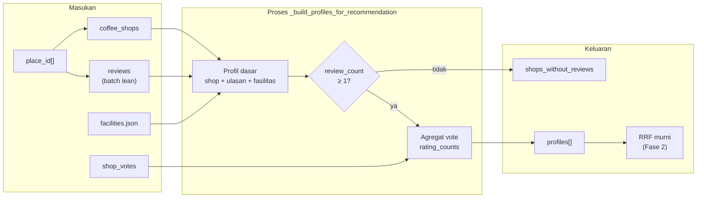

# BAB 4 HASIL DAN IMPLEMENTASI

> **Catatan penulisan.** Seluruh nilai pada tabel bertanda *(ilustrasi)* adalah contoh representatif yang disusun dari struktur data dan parameter nyata sistem (`pill_config.py`, `hybrid_retrieval.py`, `rerank_blend.py`, `docs/kalibrasi-parameter.md`) agar alur transformasi data dapat ditelusuri pembaca. Nilai metrik evaluasi pada Subbab 4.9 **harus diisi** dari hasil eksekusi skrip evaluasi sebelum laporan diserahkan.

---

## 4.1 Gambaran Umum Implementasi Sistem

Sistem Cofind diimplementasikan sebagai aplikasi web rekomendasi kedai kopi di Kota Pontianak yang memanfaatkan ulasan pengguna sebagai bukti utama (*review-grounded recommendation*). Arsitektur mengikuti paradigma *Retrieval-Augmented Generation* (RAG) tiga fase, yaitu (i) pembentukan profil toko, (ii) pencarian kandidat secara hibrida, dan (iii) pemeringkatan ulang berbasis kutipan ulasan, yang diakhiri dengan pembangkitan ringkasan yang dibatasi oleh bukti. Pengguna menyatakan preferensi melalui salah satu dari dua jalur yang saling eksklusif, yakni pilihan preferensi terstruktur (*pill*) atau teks bebas (*free text*) berpanjang maksimum 100 karakter. Bagian ini memetakan seluruh fase pemrosesan sehingga pembaca dapat memahami keterkaitan antarsubbab selanjutnya.

**Tabel 4.1 Ringkasan fase implementasi: data awal dan keluaran**

| Fase | Subbab | Data awal (masukan) | Keluaran (diteruskan ke fase berikutnya) |
|------|--------|---------------------|-------------------------------------------|
| Akuisisi korpus | 4.2.1 | Kandidat toko hasil pencarian Places API | Berkas *staging* toko beserta ulasan |
| Prapemrosesan ulasan | 4.2.2 | Teks ulasan mentah | Ulasan bersih, ternormalisasi, dan terpecah per klausa |
| Profil toko (Fase 1) | 4.2.3 | Ulasan bersih per toko | Profil toko dengan skor kualitas |
| Representasi vektor | 4.2.4 | Klausa/ulasan bersih | Vektor 384 dimensi per ulasan |
| Preferensi pill | 4.3.2 | Kode pill terpilih | Token sparse dan teks *dense query* |
| Preferensi teks bebas | 4.3.3 | Kalimat bebas pengguna | `keywords`, `dense_query`, kelas kueri |
| Retrieval hibrida (Fase 2) | 4.4 | Token sparse, teks dense, profil toko | Daftar kandidat top-7 beserta skor |
| Pembentukan bukti | 4.5 | Kandidat dan ulasannya | Kutipan terurut dengan verdict sentimen |
| *Rerank* (Fase 3) | 4.6 | Kutipan per kandidat | Urutan akhir 0–3 toko |
| Ringkasan | 4.7 | Toko terpilih dan kutipan | Ringkasan tergrounding |

---

## 4.2 Implementasi Data dan Prapemrosesan

### 4.2.1 Akuisisi Korpus Kedai Kopi

Korpus penelitian dibangun dari Google Places API dengan cakupan geografis Kota Pontianak. Kandidat dikelompokkan ke dalam tiga tingkatan heuristik, yaitu `hidden_gem`, `modern_specialty`, dan `research_diverse`, dengan syarat minimum 50 ulasan publik per toko, serta pembatasan maksimum dua cabang untuk setiap merek guna mengurangi bias duplikasi. Tahap ini bertujuan menghasilkan himpunan toko yang beragam dan memiliki identitas unik (`place_id`) sebelum ulasan dimuat ke basis data. Kandidat yang telah ada pada tabel `coffee_shops` dikeluarkan (*deduplication*), kemudian data divalidasi sebelum diimpor.

**Tabel 4.2 Masukan dan keluaran akuisisi korpus**

| Aspek | Bentuk data awal (masukan) *(ilustrasi)* | Bentuk keluaran |
|-------|------------------------------------------|-----------------|
| Sumber | Hasil `searchText` Places API (jenis `cafe`, `coffee_shop`) | Berkas `pontianak_coffee_new_staging.json` |
| Atribut toko | `place_id`: `ChIJBYqZVwBZHS4Rk3hdsQzoQSo`; `name`: Kedai X; `rating`: 4.7; `total_reviews`: 132 | Entri toko tervalidasi, bertanda tingkat (`tier`) dan `selection_notes` |
| Ulasan | Maks. 5 ulasan Google per toko baru (urutan `newest`) | Larik `reviews[]` per toko |
| Ukuran target | 15 toko eksisting + 35 toko baru | 50 toko dalam basis data |

### 4.2.2 Prapemrosesan Teks Ulasan

Ulasan berbahasa Indonesia informal memuat variasi ejaan, singkatan, dan istilah gaul sehingga pencocokan leksikal menjadi tidak konsisten. Oleh karena itu dilakukan serangkaian transformasi yang mencakup penyaringan ulasan terlalu pendek (kurang dari 6 karakter), penghapusan duplikasi teks, pengubahan huruf menjadi huruf kecil, penghilangan diakritik dan tanda baca, normalisasi slang berbasis kamus, serta pemecahan ulasan menjadi klausa pada tanda baca kuat dan konjungsi kontras (misalnya *tapi*, *namun*). Kamus domain kedai kopi diberi prioritas tertinggi atas kamus slang umum agar istilah seperti *wfc* dan *colokan* terpetakan secara konsisten. Pemecahan klausa diperlukan agar ulasan bernada campuran dapat dinilai bagian demi bagian.

**Tabel 4.3 Masukan dan keluaran prapemrosesan ulasan**

| Aspek | Bentuk data awal (masukan) *(ilustrasi)* | Bentuk keluaran |
|-------|------------------------------------------|-----------------|
| Teks ulasan | `"Wifinya ngebut, colokan banyak. Cocok buat WFC, tapi agak berisik pas weekend."` | `"wifinya ngebut stopkontak banyak cocok buat work from cafe tapi agak berisik pas weekend"` |
| Pemetaan domain | `wfc`, `colokan`, `mushola` | `work from cafe`, `stopkontak`, `musholla` |
| Klausa | Satu string ulasan utuh | `["Wifinya ngebut", "colokan banyak", "Cocok buat WFC", "agak berisik pas weekend"]` |
| Ulasan tidak layak | `"ok"` (kurang dari 6 karakter); ulasan identik berulang | Dibuang dari himpunan ulasan yang dapat digunakan |

### 4.2.3 Pembentukan Profil Toko (Fase 1)

Fase pertama memuat seluruh toko beserta ulasannya secara *batch* (`_build_profiles_for_recommendation`) dan menerapkan penyaringan keras (*hard filter*) berupa syarat minimum satu ulasan (`REVIEW_BASED_MIN_REVIEWS = 1`). Setiap toko yang lolos direpresentasikan sebagai objek **profil** yang memuat identitas, ulasan lean, agregat rating bintang, tab fasilitas, dan sinyal komunitas (reaksi vote). Fase 2 retrieval memakai **RRF murni** (BM25 + dense) secara default (`COFIND_RETRIEVAL_QUALITY_WEIGHT=0`). Fungsi `_quality_score_for_profile` tetap tersedia untuk ablation opsional, tetapi **tidak** dihitung di pipeline produksi. Slider *overall experience* tidak memengaruhi skor; *top pros* tidak dimuat di pipeline rekomendasi.

**Tabel 4.4 Sumber data mentah (masukan) pembentukan profil**

| No | Sumber | Kolom / isi mentah *(contoh)* | Keterangan |
|----|--------|----------------------------------|------------|
| 1 | Daftar `place_id` katalog | `["ChIJ…", "ChIJ…", …]` | Semua toko aktif; opsional `excluded_place_ids` (pipeline rekomendasi biasanya kosong) |
| 2 | Tabel `coffee_shops` | `place_id`, `name`, `rating`, `total_reviews`, `opening_hours_display` | Satu query `IN (place_id…)` |
| 3 | Tabel `reviews` | `id`, `place_id`, `rating`, `review_text`, `review_source`, `author_display_name`, … | Batch lean via `get_reviews_for_recommendation_batch`; hanya sumber pipeline (Cofind + Google Places); tanpa foto/like |
| 4 | Tabel `shop_votes` | `presence`, `rating` (love/like/…), `pelayanan`, `kebersihan`, `kenyamanan`, `harga`, `best_for` | Agregasi batch `get_vote_summaries_batch`; **bintang ulasan tidak** digabung ke `rating_counts` rekomendasi |
| 5 | Indeks `facilities.json` | `facilities.popular_for`, `highlights`, `atmosphere`, … per `place_id` | `load_facilities_index()`; konteks profil, bukan bobot retrieval utama |

**Tabel 4.5 Keluaran objek profil per toko (`profile`)**

| Field keluaran | Bentuk nilai *(ilustrasi)* | Asal / transformasi |
|----------------|----------------------------|---------------------|
| `place_id`, `name` | `"ChIJ…"`, `"Kopi Kenangan …"` | Langsung dari `coffee_shops` |
| `reviews[]` | `[{ "id", "text", "rating", "username", … }, …]` | Baris `reviews` → `_review_row_to_api_dict` |
| `review_count` | `24` | `len(reviews)` |
| `avg_user_rating` | `4.6` | Rata-rata `rating` bintang 1–5 pada ulasan profil |
| `google_rating`, `google_total_reviews` | `4.7`, `312` | Kolom `rating`, `total_reviews` toko |
| `opening_hours_display` | `"Sen–Min 08:00–22:00"` | Kolom jam buka |
| `facilities_tab`, `facilities_tab_text`, `facilities_raw` | Label populer/keunggulan/suasana + teks ringkas | `_format_facilities_tab_signals` dari indeks fasilitas |
| `community_signals.vote.total_votes` | `15` | Jumlah baris `shop_votes` |
| `community_signals.vote.rating_counts` | `{ "love": 8, "like": 4, "ok": 2, … }` | Agregat reaksi; **tidak** memengaruhi ranking (konteks prompt/UI) |
| `community_signals.vote.slider_averages` | `{ "pelayanan": 4.2, … }` | Rata-rata slider 1–5 (hanya konteks prompt jika env diaktifkan) |

**Tabel 4.6 Keluaran fungsi build profile (tingkat pipeline)**

| Keluaran | Bentuk | Arti |
|----------|--------|------|
| `profiles` | `List[profile]` | Kandidat Fase 2+ yang memiliki ≥ 1 ulasan |
| `shops_without_reviews` | `List[place_id]` | Toko ada di DB tetapi `review_count < 1` |
| Fase 2 retrieval | Hybrid BM25 + dense → RRF | Default tanpa blend `quality_by_place`; bobot quality opsional via env |

**Tabel 4.7 Penyaringan pada build profile**

| Kondisi masukan | Keluaran |
|-----------------|----------|
| `review_count ≥ 1` | Profil masuk `profiles` |
| `review_count = 0` | `place_id` masuk `shops_without_reviews`; tidak ikut retrieval |
| Toko tidak ada di `coffee_shops` | Dilewati (tidak ada profil) |

#### Studi kasus satu `place_id` (data basis Cofind)

Contoh berikut memakai toko **Haruna Cafe**, `place_id = ChIJhx6zl0BZHS4RGNla_oPoIJ0`. Tabel 4.8–4.11 menampilkan cuplikan **masukan mentah** dari database. **Keluaran riil** Fase 1 disajikan pada Tabel 4.12–4.17 (format laporan).

**Tabel 4.8 Masukan mentah — baris `coffee_shops`**

| Kolom | Nilai pada database |
|-------|---------------------|
| `place_id` | `ChIJhx6zl0BZHS4RGNla_oPoIJ0` |
| `name` | Haruna Cafe |
| `rating` | 4.7 |
| `total_reviews` | 652 |
| `opening_hours_display` | Senin–Minggu: 07.00–23.30 (satu baris per hari) |

**Tabel 4.9 Masukan mentah — cuplikan baris `reviews` *(5 dari 10 baris pipeline)*

| `id` | `review_source` | `rating` | `author_display_name` | Cuplikan `review_text` |
|------|-----------------|----------|------------------------|-------------------------|
| 125 | cofind | 4.0 | — | Pengalaman pertama yang cukup menyenangkan. Lokasi dipinggir jalan besar. Tersedia parkir motor dan mobil… |
| 126 | cofind | 5.0 | — | Salah satu coffeshop aesthetic di Pontianak, tempatnya bersih nyaman buat nongki atau ngerjain tugas kuliah… |
| 127 | cofind | 5.0 | — | Cocok untuk WFH dan menyendiri; tersedia ruangan ber-AC dan outdoor… |
| 346 | google_places | 4.0 | Windi Arum Mukti | Areanya enak, lebih sepi, nyaman untuk WFC… |
| 349 | google_places | 5.0 | Minisché Chio | Suasana enak buat WFC; interior, minuman, AC, Wi‑Fi, colokan oke… |

| Ringkasan batch | Nilai |
|-----------------|-------|
| Total baris `reviews` untuk `place_id` ini | 10 |
| Sumber | 5 Cofind + 5 Google Places |
| Rata-rata bintang ulasan *(dihitung di profil)* | 4.8 |

**Tabel 4.10 Masukan mentah — baris `shop_votes` dan agregat**

| `presence` | `rating` (reaksi) | Slider `pelayanan` … `harga` |
|------------|-------------------|--------------------------------|
| been | love | *(null pada kelima baris)* |
| been | like | *(null)* |
| been | love | *(null)* |
| been | love | *(null)* |
| been | love | *(null)* |

| Agregat *(setelah `get_vote_summaries_batch`)* | Nilai |
|------------------------------------------------|-------|
| `total_votes` | 5 |
| `rating_counts.love` | 4 |
| `rating_counts.like` | 1 |
| `rating_counts.ok` / `dislike` / `hate` | 0 |

**Tabel 4.11 Masukan mentah — entri `facilities.json` *(ringkas)*

| Kunci | Nilai mentah |
|-------|----------------|
| `popular_for` | lunch, brunch, dinner, breakfast, solo_dining, good_for_working_on_laptop |
| `highlights` | good_coffee, good_desserts, good_tea_selection |
| `atmosphere` | nyaman, santai, trendi |

Keluaran riil Fase 1 untuk `place_id` yang sama disajikan pada **Tabel 4.12–4.17**. Nilai diambil langsung dari tuple `_build_profiles_for_recommendation` (Oktober 2026). Inspeksi terminal: `python scripts/inspect_build_profile_tuple.py`.

**Tabel 4.12 Keluaran fungsi `_build_profiles_for_recommendation` — ringkasan**

| Keluaran | Nilai |
|----------|-------|
| Jumlah elemen `profiles` | 1 |
| `shops_without_reviews` | [] (kosong) |
| Fase 2 retrieval *(setelah profil)* | RRF murni (`COFIND_RETRIEVAL_QUALITY_WEIGHT=0`) |

**Tabel 4.13 Keluaran profil — identitas dan agregat rating**

| Field | Nilai keluaran |
|-------|----------------|
| `place_id` | ChIJhx6zl0BZHS4RGNla_oPoIJ0 |
| `name` | Haruna Cafe |
| `review_count` | 10 |
| `avg_user_rating` | 4.8 |
| `google_rating` | 4.7 |
| `google_total_reviews` | 652 |
| `opening_hours_display` | Senin–Minggu 07.00–23.30 (detail per hari disimpan di objek profil) |

**Tabel 4.14 Keluaran profil — `facilities_tab` dan teks ringkas**

| Komponen | Nilai keluaran |
|----------|----------------|
| `popular_for[]` | sarapan, brunch, makan siang, makan malam, makan sendiri, wfc / kerja laptop |
| `highlights[]` | kopi enak, dessert enak, pilihan teh beragam |
| `atmosphere[]` | nyaman, santai, trendi |
| `facilities_tab_text` | Populer untuk: sarapan, brunch, makan siang, makan malam, makan sendiri, wfc / kerja laptop. Keunggulan: kopi enak, dessert enak, pilihan teh beragam. Suasana: nyaman, santai, trendi. |

**Tabel 4.15 Keluaran profil — `community_signals.vote`**

| Field | Nilai keluaran |
|-------|----------------|
| `total_votes` | 5 |
| `rating_counts.love` | 4 |
| `rating_counts.like` | 1 |
| `rating_counts.ok` | 0 |
| `rating_counts.dislike` | 0 |
| `rating_counts.hate` | 0 |
| `slider_averages.pelayanan` | — |
| `slider_averages.kebersihan` | — |
| `slider_averages.kenyamanan` | — |
| `slider_averages.harga` | — |

**Tabel 4.16 Keluaran profil — elemen `reviews[]` *(10 baris)*

| No | `id` | Sumber | Bintang | Penulis | Cuplikan `text` |
|----|------|--------|---------|---------|-------------------|
| 1 | 125 | cofind | 4.0 | fulvi | Pengalaman pertama yang cukup menyenangkan. Lokasi dipinggir jalan besar. Tersedia parkir motor dan mobil yg memadai. Dekorasi ruangan yang estetik. Ada pilihan outdoor dan indoor. Ada booth buat foto sama teman-teman… |
| 2 | 126 | cofind | 5.0 | vaegerys | salah satu coffeshop aesthetic di Pontianak tempatnya bersih nyaman banget buat sekedar nongki sama temen atau ngerjain tugas kuliah. ada indoor dan outdoor yang instagramable buat foto-foto. salah satu pelayannya bes… |
| 3 | 129 | cofind | 5.0 | qwerty | Tempatnya bagus banget buat nongki sama temen ataupun sambil buat tugas kuliah lama2.. makanannya enak dan coffenya juga enak.. ada makanan yang kids friendly juga kok.. tadi makanannya lupa ke foto |
| 4 | 127 | cofind | 5.0 | vseeker | Rate 9.5/10 Salah satu tempat nyantai pontianak yang cocok untuk WFH dan menyendiri dan ada photoboxnya juga. Tersedia ruangan ber ac dan outdoor yang estetik. best seller menurut aku disini adalah cromboloni nya enak… |
| 5 | 128 | cofind | 5.0 | aegon | Suasana cafenya bagus namun sedikit minimalis tidak terlalu luas. Untuk makanan dan minuman enak sesuai dengan harganya walaupun ada sedikit kekurangan tapi tidak terlalu bermasalah. Pelayanan cukup gesit dan ramah. T… |
| 6 | 346 | google_places | 4.0 | Windi Arum Mukti | Areanya enak sih, lebih sepi dibanding Haruna cabang lainnya, tapi jadi nyaman untuk WFC atau kalau mau tenang.. Untuk makanannya bervariatif dan bisa buat anak anak. Dessertnya juga ada buat nyemil nyemil setelah makan. |
| 7 | 348 | google_places | 5.0 | Nia Kajolania1808 | Tempat nya nyaman bangeet, pas tuk pertemuan, ketemu temen,  kumpul keluarga , tempat ngerjain tugas ketik,  pelayanan ramah, perfect sih ini |
| 8 | 347 | google_places | 5.0 | UulUul Aulia | Suasana yang sudahh baruuuu dan luasss. Emg jadi andalan klo lagi malam minggu dekat sm rumah , makaanan dan minumannyaaa enak2. Emang andalan kopi harunaa sihhh THE BEST 💙💙💙💙💙 klo kesana jgn kupa carbonara creamy dan… |
| 9 | 350 | google_places | 5.0 | Dia Rom | Pelayanan nya bagus banget sangat ramah dan helpfull dibantuin buka pintu karna lagi pegang byk barang, hargany juga terjangkau tempatnya bagus, bikin bahagia datang kesini. Ada banyak buku juga utk dibaca. Outdoor ny… |
| 10 | 349 | google_places | 5.0 | Minisché Chio | Tempatnya cantik bangeeet, suasananya enak buat wfc, interior, minuman, makanan, ac, wifi colokan smua oke. Paling bbrp seat g ada colokan. Mau indoor outdoor smua cantik2. Rsanya ga banyak yg tau, tryta hidden gem. J… |

**Tabel 4.17 Keluaran profil — cuplikan `facilities_raw` *(boolean aktif)*

| Grup | Atribut aktif (`true`) |
|------|-------------------------|
| `popular_for` | lunch, brunch, dinner, breakfast, solo_dining, good_for_working_on_laptop |
| `highlights` | good_coffee, good_desserts, good_tea_selection |
| `service_options` | dine_in, delivery, takeaway, reservable, outdoor_seating, contactless_delivery |
| `dining_options` | lunch, brunch, dinner, dessert, seating, breakfast, table_service |
| `payments` | debit_card, credit_card, nfc_mobile_payments |
| `parking` | paid_parking_lot, parking_available, paid_street_parking |
| `amenities` | toilet |
| `planning` | accepts_reservations |
| `children` | good_for_kids |
| `offerings` | coffee, quick_bite |
| `meta` | {"source": "google_places_api_legacy", "last_updated": "2026-10-20"} |

**Gambar 4.1 Alur transformasi data pembentukan profil (Fase 1)**

Diagram berikut merangkum Tabel 4.4–4.7: sumber mentah di kiri, penggabungan profil dan agregat vote di tengah, serta cabang penyaringan ulasan dan keluaran pipeline.

*Catatan laporan:* salin diagram ke editor yang mendukung Mermaid (mis. draw.io, Mermaid Live Editor, atau ekspor PNG dari VS Code) untuk disisipkan sebagai gambar di naskah. Visualisasi interaktif yang sama tersedia di repositori sebagai referensi desain (tab *Peta data* / *Contoh profil*).

### 4.2.4 Representasi Vektor Ulasan

Pencocokan semantik membutuhkan representasi numerik yang mampu menangkap parafrase dan sinonim yang tidak terjangkau pencocokan kata. Setiap ulasan dikodekan menggunakan model `intfloat/multilingual-e5-small` menjadi vektor 384 dimensi ternormalisasi L2, sehingga kemiripan kosinus setara dengan hasil kali titik. Vektor disimpan pada tabel `review_embeddings` (pgvector) dengan indeks HNSW, dan sebuah *hash* sumber teks serta identitas model disimpan untuk mendeteksi vektor kedaluwarsa. Pengodean ulasan dilakukan saat ulasan ditulis atau melalui proses *backfill*, sedangkan pengodean kueri dilakukan pada saat permintaan.

**Tabel 4.14 Masukan dan keluaran representasi vektor**

| Aspek | Bentuk data awal (masukan) *(ilustrasi)* | Bentuk keluaran |
|-------|------------------------------------------|-----------------|
| Teks | `"Wifinya ngebut, colokan banyak"` (setelah pembersihan klausa, maks. 350 karakter) | Vektor `float32[384]` |
| Identitas | `review_id = 1021`, `model_id = multilingual-e5-small` | Baris `review_embeddings` + `source_text_hash` |
| Kueri | `"wifinya kencang dan stabil, internetnya lancar"` | Vektor kueri `float32[384]` |

---

## 4.3 Implementasi Penerimaan dan Pemetaan Preferensi

### 4.3.1 Antarmuka dan Validasi Masukan

Antarmuka pengguna menyediakan dua jalur masukan yang saling meniadakan: pilihan *pill* dan kotak teks bebas. Pembatasan ini ditegakkan pada antarmuka dan diverifikasi ulang pada sisi peladen sehingga satu permintaan tidak pernah memuat keduanya. Teks bebas dinormalisasi dengan membuang karakter selain alfanumerik, spasi, dan koma, lalu dipotong hingga 100 karakter. Pill dikelompokkan menjadi pill aktivitas (misalnya Kerja/WFC, Belajar) dan pill atribut fasilitas (misalnya Wifi kencang, Musholla).

**Tabel 4.15 Masukan dan keluaran validasi masukan**

| Aspek | Bentuk data awal (masukan) *(ilustrasi)* | Bentuk keluaran |
|-------|------------------------------------------|-----------------|
| Jalur pill | `prefs = ["kerja", "wifi_kencang"]` | `activity = ["kerja"]`, `attribute = ["wifi_kencang"]` |
| Jalur teks bebas | `query_text = "tempat kerja tenang, deket kampus!!"` | `"tempat kerja tenang, deket kampus"` |
| Masukan ganda | Pill dan `query_text` terisi bersamaan | Ditolak dengan kode HTTP 400 |

### 4.3.2 Pemetaan Pill Menjadi Kueri Sparse dan Dense

Setiap pill pada `PILL_MAPPING` memiliki peran field yang berbeda. Kolom `review_keywords` hanya memuat jangkar leksikal yang lemah ditangkap model semantik, seperti slang dan singkatan, sedangkan kolom `dense_query` memuat satu konsep dalam gaya bahasa ulasan tanpa negasi. Label antarmuka tidak dipakai sebagai token pencarian karena menghasilkan token umum yang bertabrakan dengan banyak ulasan. Kolom `negative_scope` tidak pernah dimasukkan ke teks dense. Kueri sparse dibentuk dengan meratakan seluruh `review_keywords` menjadi unigram setelah normalisasi slang, sedangkan kueri dense dibentuk dengan menyambung `dense_query` setiap pill. Apabila terdapat pill aktivitas, daftar BM25 dan teks dense untuk pemeringkatan toko dibatasi pada pill aktivitas, sementara pill atribut dipakai pada tahap pembentukan bukti.

**Tabel 4.16 Masukan dan keluaran pemetaan pill**

| Aspek | Bentuk data awal (masukan) | Bentuk keluaran |
|-------|----------------------------|-----------------|
| `review_keywords` pill `kerja` | `['kerja', 'wfc', 'laptopan', 'wfh', 'ngantor', 'kerja remote']` | Token sparse aktivitas: `kerja`, `work`, `from`, `cafe`, `laptopan`, `wfh`, `ngantor`, `remote` *(ilustrasi hasil normalisasi dan penyaringan token generik)* |
| `review_keywords` pill `wifi_kencang` | `['wifi', 'internet']` | `attribute_tokens = ['wifi', 'internet']` |
| `dense_query` pill `kerja` | `'cocok buat kerja dan wfc, laptopan berjam-jam, kerja remote'` | `activity_query_text` identik (hanya pill aktivitas) |
| `dense_query` kedua pill | Kerja + Wifi kencang | `query_text = 'cocok buat kerja dan wfc, laptopan berjam-jam, kerja remote. wifinya kencang dan stabil, internetnya lancar'` |

### 4.3.3 Ekstraksi Intent pada Jalur Teks Bebas

Pada jalur teks bebas, sebuah model bahasa besar (LLM) mengekstrak niat pencarian menjadi dua keluaran yang masing-masing dipakai oleh cabang sparse dan dense. Daftar `keywords` (1–8 token bersih tanpa kata pengisi) diteruskan ke BM25, sedangkan `dense_query` berupa satu kalimat parafrase diteruskan ke pencarian semantik. Model juga mengklasifikasikan kueri menjadi `standard`, `negative_sentiment`, `false_presupposition`, atau `off_domain`. Kueri di luar domain atau bernada superlatif negatif dihentikan lebih awal (*abstention*) disertai saran reformulasi, sedangkan presuposisi yang tidak realistis dilonggarkan dengan kata kunci alternatif. Apabila LLM tidak tersedia atau gagal, sistem beralih ke tokenisasi deterministik dan klasifikasi heuristik sehingga alur tetap berjalan.

**Tabel 4.17 Masukan dan keluaran ekstraksi intent**

| Aspek | Bentuk data awal (masukan) *(ilustrasi)* | Bentuk keluaran |
|-------|------------------------------------------|-----------------|
| Kueri standar | `"cari tempat kerja tenang deket kampus"` | `keywords = ["kerja", "tenang", "kampus"]`; `dense_query = "coffee shop tenang untuk kerja dekat kampus"`; `query_class = standard` |
| Kueri negatif | `"coffee shop paling jelek"` | `query_class = negative_sentiment`; berhenti dini dengan pesan abstensi |
| Kueri luar domain | `"asdf qwer"` | `query_class = off_domain`; saran reformulasi *in-domain* |
| LLM gagal | `"wifi kencang colokan"` | `backend = fallback`; `keywords = ["wifi", "kencang", "colokan"]`; `dense_query` = teks mentah |

---

## 4.4 Implementasi Retrieval Hibrida (Fase 2)

### 4.4.1 Pencarian Sparse Berbasis BM25

Cabang sparse menilai kecocokan leksikal antara token kueri dan seluruh ulasan suatu toko. Setiap toko diperlakukan sebagai satu dokumen yang dibentuk dari penggabungan seluruh teks ulasannya yang telah dinormalisasi, kemudian dihitung skor BM25 Okapi terhadap token kueri. Sebagai alternatif, penilaian dapat dialihkan ke *full-text search* PostgreSQL (`ts_rank_cd`) melalui konfigurasi `COFIND_BM25_BACKEND`. Skor mentah tidak dinormalisasi karena yang diteruskan ke tahap fusi hanyalah urutan peringkat dengan lebar kolam 50 toko.

**Tabel 4.18 Masukan dan keluaran pencarian sparse**

| Aspek | Bentuk data awal (masukan) *(ilustrasi)* | Bentuk keluaran |
|-------|------------------------------------------|-----------------|
| Dokumen | Toko A: `"wifinya ngebut stopkontak banyak cocok buat work from cafe ..."` | Korpus token per toko |
| Kueri | `['kerja', 'work', 'from', 'cafe', 'laptopan', 'wfh', 'ngantor', 'remote']` | `bm25_raw`: A = 11,42; B = 9,87; C = 7,15; toko lain = 0 |
| Daftar peringkat | `bm25_raw` | `bm25_rank_list = [A, B, C, ...]` (maks. 50, skor > 0) |

### 4.4.2 Pencarian Dense Berbasis Embedding

Cabang dense menilai kedekatan makna antara teks kueri dan ulasan. Kueri dikodekan satu kali menggunakan model E5 dengan awalan `query:` otomatis, lalu pencarian *Approximate Nearest Neighbor* (ANN) pada pgvector mengambil 300 ulasan terdekat yang dibatasi pada himpunan `place_id` dari Fase 1. Skor sebuah toko ditetapkan sebagai kemiripan tertinggi di antara ulasannya (*max-pooling*). Apabila ANN gagal atau tidak mengembalikan baris, sistem beralih ke jalur cadangan yang mengodekan paling banyak 20 ulasan per toko, dengan prioritas pada ulasan yang memuat bukti aktivitas dan tumpang tindih token.

**Tabel 4.19 Masukan dan keluaran pencarian dense**

| Aspek | Bentuk data awal (masukan) *(ilustrasi)* | Bentuk keluaran |
|-------|------------------------------------------|-----------------|
| Kueri | `activity_query_text = 'cocok buat kerja dan wfc, laptopan berjam-jam, kerja remote'` | Vektor kueri 384 dimensi |
| Ulasan terpilih | 300 baris hasil ANN, mis. `(review 1021, toko A, sim 0,78)`, `(review 2230, toko B, sim 0,81)` | `dense_raw`: A = 0,78; B = 0,81; C = 0,69 |
| Daftar peringkat | `dense_raw` | `dense_rank_list = [B, A, C, ...]` |

### 4.4.3 Fusi Peringkat dan Pembobotan Kualitas

Dua daftar peringkat digabung menggunakan *Reciprocal Rank Fusion* (RRF) dengan konstanta *k* = 60, yaitu \( \mathrm{RRF}(d)=\sum_{r}\frac{1}{k+\mathrm{rank}_r(d)} \). Pada jalur pill beraktivitas, terdapat daftar peringkat ketiga yang dibentuk dari skor aktivitas leksikal tertinggi per toko tanpa embedding. Skor RRF dinormalisasi terhadap nilai maksimum, kemudian dipadukan dengan skor kualitas toko dengan bobot 0,9 untuk relevansi dan 0,1 untuk kualitas: \( s = 0{,}9\,\mathrm{RRF}_{norm}+0{,}1\,q \). Penormalisasian diperlukan karena nilai RRF mentah berada pada kisaran 0,016–0,033 sehingga tanpa normalisasi komponen kualitas akan mendominasi.

**Tabel 4.20 Masukan dan keluaran fusi peringkat**

| Toko | Peringkat BM25 | Peringkat dense | Peringkat leksikal aktivitas | RRF mentah | RRF norm | Kualitas *q* | Skor akhir *s* |
|------|:--:|:--:|:--:|:--:|:--:|:--:|:--:|
| A *(ilustrasi)* | 1 | 2 | 1 | 0,048915 | 1,0000 | 0,80 | 0,9800 |
| B *(ilustrasi)* | 2 | 1 | 2 | 0,048651 | 0,9946 | 0,90 | 0,9851 |
| C *(ilustrasi)* | 3 | 3 | 3 | 0,047619 | 0,9735 | 0,70 | 0,9462 |

Keluaran tahap ini berupa daftar terurut menurut skor akhir: B, A, C. Perhatikan bahwa toko B melampaui toko A meskipun RRF mentahnya sedikit lebih rendah karena kontribusi skor kualitas.

### 4.4.4 Gerbang Aktivitas

Pada jalur pill yang memuat pill aktivitas, setiap kandidat diverifikasi memiliki bukti leksikal aktivitas pada setidaknya satu ulasan melalui pencocokan frasa khas, kata utuh, dan akronim berkonteks. Klausa yang berisi penolakan, misalnya "kurang cocok" atau "tidak disarankan", tidak dihitung sebagai bukti sehingga penolakan untuk satu aktivitas tidak menenggelamkan bukti aktivitas lain. Kemiripan semantik di atas ambang 0,55 hanya dicatat sebagai telemetri dan tidak mengizinkan toko lolos. Kandidat yang lolos diurutkan dan dipotong menjadi tujuh teratas untuk diteruskan ke tahap berikutnya.

**Tabel 4.21 Masukan dan keluaran gerbang aktivitas**

| Aspek | Bentuk data awal (masukan) *(ilustrasi)* | Bentuk keluaran |
|-------|------------------------------------------|-----------------|
| Daftar fusi | `[B, A, C, D, ...]` dengan skor akhir | Kandidat bersih dengan `activity_pass_mode` |
| Ulasan toko D | `"Enak buat nongkrong, tidak cocok untuk kerja."` | Ditolak (klausa mengandung penolakan; tidak ada bukti aktivitas lain) |
| Hasil | 13 toko lolos gerbang (`activity_gated`) | `retrieval.candidates` top-7 dengan `score_detail` (`bm25_raw`, `dense_raw`, `rrf_score`, `retrieval_score`) |

---

## 4.5 Implementasi Pembentukan Bukti

### 4.5.1 Pemeringkatan Ulasan Pendukung per Toko

Setelah kandidat toko ditetapkan, sistem memilih ulasan yang paling relevan sebagai bukti. Pada tahap ini hingga 60 ulasan per toko dinilai dengan skor gabungan yang menimbang kemiripan dense terhadap teks aktivitas, kecocokan leksikal aktivitas, kemiripan dense terhadap kueri penuh, dan kecocokan leksikal atribut, dengan bobot masing-masing 0,45, 0,30, 0,15, dan 0,10. Ulasan yang secara eksplisit memuat bukti aktivitas memperoleh bonus tambahan 0,45 dan dijamin berada di depan, sehingga kutipan yang membahas aktivitas tidak tergeser oleh kutipan fasilitas umum. Delapan ulasan teratas dipertahankan.

**Tabel 4.22 Masukan dan keluaran pemeringkatan ulasan**

| Aspek | Bentuk data awal (masukan) *(ilustrasi)* | Bentuk keluaran |
|-------|------------------------------------------|-----------------|
| Ulasan toko B | (r1) `"Cocok WFC, laptopan seharian"`; (r2) `"Wifi lancar"`; (r3) `"Kopinya enak"` | Daftar berskor: r1 = 1,03; r2 = 0,38; r3 = 0,12 |
| Penanda | Ulasan memuat frasa aktivitas | `act_hit > 0` → bonus 0,45 dan posisi terjamin |
| Hasil | 60 ulasan terpindai | `evidence.review_quotes` (maks. 8 kutipan) dengan `pill` dan `reason` |

### 4.5.2 Analisis Sentimen Klausa dan Triase

Kutipan yang diperoleh perlu dibedakan antara yang mendukung preferensi (*supporting*) dan yang memuat keberatan (*caveat*). Sistem menerapkan model `damasukma/indobert-absa` untuk menilai pasangan aspek dan klausa, kemudian skor keyakinan dikelompokkan oleh triase berambang ganda (τ_low = 0,35 dan τ_high = 0,72) menjadi *accept*, *reject*, atau *needs_llm*. Pasangan pada pita ambigu diserahkan ke LLM bila tersedia. Keluaran tahap ini hanya memberi label pada kutipan dan tidak mengubah urutan toko hasil Fase 2.

**Tabel 4.23 Masukan dan keluaran analisis sentimen klausa**

| Aspek | Bentuk data awal (masukan) *(ilustrasi)* | Bentuk keluaran |
|-------|------------------------------------------|-----------------|
| Pasangan | (aspek `kerja`, klausa `"Cocok buat WFC"`) | Skor 0,86 ≥ 0,72 → *accept*, verdict *supporting* |
| Pasangan | (aspek `suasana_tenang`, klausa `"agak berisik pas weekend"`) | Skor 0,20 < 0,35 → *reject*, verdict *caveat* |
| Pasangan ambigu | (aspek `kerja`, klausa `"lumayan buat duduk lama"`) | Skor 0,50 → *needs_llm* |

---

## 4.6 Implementasi Pemeringkatan Ulang dengan *Cross-Encoder* (Fase 3)

Pemeringkatan ulang menggunakan model `jinaai/jina-reranker-v2-base-multilingual` yang memproses pasangan kueri dan kutipan secara bersama (*joint encoding*) sehingga mampu menangkap interaksi antartoken yang tidak tertangkap oleh model *bi-encoder*. Kueri dibentuk dari teks dense aktivitas, label pill aktivitas, dan baris kata kunci. Setiap kandidat diwakili paling banyak enam kutipan terbaik, lalu skor mentah dinormalisasi *min–max* menjadi skor kecocokan (*fit*) 0–10 dari kutipan terbaik. Kutipan terbaik wajib memuat bukti aktivitas; bila tidak, sistem memilih kutipan peringkat berikutnya yang memenuhi syarat. Skor akhir dihitung sebagai \( s_{final}=w\cdot\frac{fit}{10}+(1-w)\cdot s_{hybrid} \) dengan \( w=0{,}6 \), sehingga kandidat dapat berpindah peringkat terhadap urutan hibrida.

**Tabel 4.24 Masukan dan keluaran *rerank***

| Toko | Skor hibrida | Kutipan terbaik (masukan) *(ilustrasi)* | *Fit* (0–10) | Skor akhir | Peringkat hibrida → akhir |
|------|:--:|--------------------------------|:--:|:--:|:--:|
| A | 0,9800 | `"Wifinya ngebut, cocok WFC seharian"` | 7,0 | 0,8120 | 2 → 2 |
| B | 0,9851 | `"Colokan banyak, enak laptopan berjam-jam"` | 9,0 | 0,9340 | 1 → 1 |
| C | 0,9462 | `"Kopi enak, lumayan buat duduk"` | 4,0 | 0,6185 | 3 → 3 |

Keluaran tahap ini adalah urutan akhir dan paling banyak tiga toko yang memenuhi batas minimum kecocokan (`COFIND_LLM_MIN_FIT` = 5,0) beserta kutipan pendukung dan *caveat*. Hasil *rerank* disimpan pada cache untuk mempercepat permintaan berulang.

---

## 4.7 Implementasi Pembangkitan Ringkasan Tergrounding

Pada tahap akhir, LLM menghasilkan ringkasan alasan rekomendasi untuk setiap toko terpilih. Model hanya diberi kutipan ulasan yang telah diverifikasi dan diwajibkan hanya mengutip kalimat yang benar-benar ada pada ulasan. Pemeriksaan *grounding* membandingkan setiap kutipan keluaran terhadap korpus ulasan toko; kutipan yang tidak ditemukan dibuang dan dihitung pada telemetri. Bila LLM tidak tersedia, ringkasan deterministik berbasis templat digunakan sebagai cadangan sehingga sistem tidak gagal total.

**Tabel 4.25 Masukan dan keluaran pembangkitan ringkasan**

| Aspek | Bentuk data awal (masukan) *(ilustrasi)* | Bentuk keluaran |
|-------|------------------------------------------|-----------------|
| Konteks | Toko B, kebutuhan pengguna: `"Kerja/WFC; Wifi kencang"`, 3 kutipan *supporting*, 1 *caveat* | Ringkasan 2–3 kalimat yang menyebut kecocokan dan satu catatan keberatan |
| Verifikasi | Kutipan hasil LLM `"Colokan banyak, enak laptopan berjam-jam"` | Lolos (substring pada ulasan asli); kutipan tak ditemukan → dibuang |

---

## 4.8 Implementasi Antarmuka dan *Endpoint*

Hasil pipeline disajikan melalui *endpoint* `/api/recommend-by-preferences` dan varian *streaming* yang mengirim kemajuan tiap tahap (*intent*, profil, penilaian, *rerank*) sehingga antarmuka dapat menampilkan indikator proses. Respons mengikuti amplop seragam yang memuat status, pesan, daftar rekomendasi, dan telemetri. Pengguna dapat memberi umpan balik *helpful* atau *not_helpful* yang disimpan untuk analisis dan tidak memengaruhi penyaringan kandidat.

**Tabel 4.26 Masukan dan keluaran antarmuka**

| Aspek | Bentuk data awal (masukan) *(ilustrasi)* | Bentuk keluaran |
|-------|------------------------------------------|-----------------|
| Permintaan | `POST {"prefs": ["kerja","wifi_kencang"]}` | `{"status":"success","recommendations":[{place_id, name, score, evidence, summary}, ...]}` |
| Kueri bermasalah | `{"query_text":"asdf qwer"}` | `{"status":"success","message":"Presuposis domain tidak terverifikasi ...","recommendations":[]}` |
| Umpan balik | `{place_id, vote:"helpful"}` | Baris pada `recommendation_feedback` |

---

## 4.9 Hasil Pengujian dan Evaluasi

Evaluasi dilakukan untuk mengukur kualitas peringkat secara kuantitatif. Kueri uji diambil dari kutipan calon pengguna (jalur pill dan teks bebas) dan setiap pasangan kueri–toko dinilai relevansinya secara manual pada skala 0–3. Kualitas peringkat diukur dengan nDCG@k, Recall@k, dan MRR@k, sedangkan stabilitas hasil Fase 2 dipantau melalui *golden snapshot* tanpa *cross-encoder* dan ABSA. Hasil kuantitatif pada tabel berikut mesti diisi dari keluaran skrip evaluasi.

**Tabel 4.27 Masukan dan keluaran evaluasi**

| Aspek | Bentuk data awal (masukan) | Bentuk keluaran |
|-------|----------------------------|-----------------|
| Kueri uji | `eval_queries.json`: `{id, route, input, verbatim}` | Daftar kueri berlabel jalur |
| Penilaian | `relevance_judgments.json`: nilai relevansi 0–3 per (kueri, toko) | Matriks relevansi acuan |
| Eksekusi | `python scripts/eval/relevance_metrics.py --judgments data/eval/relevance_judgments.json --run-retrieval` | Tabel metrik per jalur |

**Tabel 4.28 Hasil metrik peringkat** *(isi dari hasil eksekusi)*

| Konfigurasi | Jalur | nDCG@3 | nDCG@7 | Recall@7 | MRR@7 |
|-------------|-------|:--:|:--:|:--:|:--:|
| BM25 saja | Pill | [isi] | [isi] | [isi] | [isi] |
| Dense saja | Pill | [isi] | [isi] | [isi] | [isi] |
| Hibrida RRF + gerbang aktivitas | Pill | [isi] | [isi] | [isi] | [isi] |
| Hibrida + *cross-encoder* | Pill | [isi] | [isi] | [isi] | [isi] |
| Hibrida RRF | Teks bebas | [isi] | [isi] | [isi] | [isi] |
| Hibrida + *cross-encoder* | Teks bebas | [isi] | [isi] | [isi] | [isi] |

---

## 4.10 Pembahasan

Hasil implementasi memperlihatkan bahwa pemisahan peran antara cabang sparse dan dense merupakan keputusan rancangan yang menentukan. Cabang sparse sengaja dibatasi pada jangkar leksikal (slang, singkatan, nama khas) karena BM25 meratakan frasa menjadi unigram sehingga kata modifikator dan kata umum menarik toko yang tidak relevan, sedangkan parafrase dan sentimen ditangani cabang dense. Penggunaan RRF yang hanya bergantung pada peringkat menghindari kebutuhan menyelaraskan skala BM25 dan kosinus, sementara normalisasi sebelum pembobotan kualitas menjaga agar relevansi tetap dominan. Gerbang aktivitas leksikal menekan positif palsu dari kemiripan semantik, dan *cross-encoder* berfungsi sebagai penyaring akhir yang membaca kutipan secara bersama dengan kueri. Keterbatasan yang perlu dicatat meliputi cakupan korpus yang masih terbatas pada 50 toko dan sejumlah kecil ulasan per toko baru, jalur teks bebas yang tidak menerapkan gerbang aktivitas sehingga lebih rentan terhadap positif palsu, serta ketergantungan ekstraksi intent pada ketersediaan LLM.
