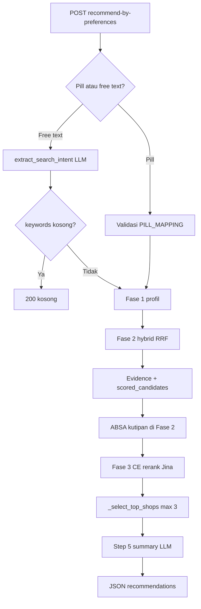

# Arsitektur Rekomendasi Cofind

## Ringkasan

Pipeline rekomendasi Cofind adalah RAG tiga fase (plus intent free-text, sentimen klausa, dan ringkasan LLM) yang diekspos lewat `/api/recommend-by-preferences` dan versi streaming (`app.py:6032–6074`). Input pill dan free text **saling eksklusif** per request (`app.py:5469–5482`, `free_text_intent.py:4–8`).

---

## KONDISI SAAT INI (Fakta Kode)

### 1. Alur end-to-end

| Tahap | Peran | Bukti |
|--------|--------|--------|
| Autentikasi & parsing | `require_authenticated_user`, `_read_recommendation_preferences` | `app.py:6035–6038` |
| Jalur pill | `valid_pills` dari `PILL_MAPPING` | `app.py:5489–5496` |
| Jalur free text | Intent → `keywords` + `dense_query`; gagal keyword → respons kosong | `app.py:5498–5533`, `free_text_intent.py:45–46` |
| LLM route probe | `probe_llm_for_recommendation_run`; mode `off` → fallback deterministik | `app.py:5543–5558` |
| Fase 1 | Batch profil + ulasan; `review_count < REVIEW_BASED_MIN_REVIEWS` (1) → bukan kandidat | `app.py:5580–5591`, `1123`, `1231–1234` |
| Sumber ulasan pipeline | `get_reviews_for_recommendation_batch` | `app.py:1210–1218`; sumber: `review_utils.py:172` |
| Fase 2 | `retrieve_top_k` (pill) atau `retrieve_top_k_by_text` | `app.py:5599–5617` |
| Quality map | `_quality_score_for_profile` per `place_id` | `app.py:5594–5597`, `2332–2342` |
| Post-retrieval | Evidence, pill coverage, clause sentiment | `app.py:5632–5715` |
| Fase 3 | `ce_rerank_candidates` jika `ce_rerank_enabled()` (Jina lokal) | `cross_encoder_rerank.py`, `recommendation/pipeline.py` |
| Seleksi akhir | `_select_top_shops` → kutipan/kontradiksi → max 3 | `app.py:5767–5836`, `5392–5423` |
| Step 5 | `_generate_llm_review_summary` | `app.py:5866–5875` |
| Respons | `recommendations` + `llm_pipeline` telemetry | `app.py:5933–5958` |

**Catatan Fase 1 vs docstring:** Docstring pipeline masih menyebut “minimal 1 review Cofind” (`app.py:5436`), sementara profil memuat ulasan dari batch unified (Cofind + Google Places) (`review_utils.py:172`) dan ambang hanya `review_count >= 1` (`app.py:1123`, `1231`).

---

### 2. Mekanisme RRF (Fase 2)

**Rumus:** untuk setiap dokumen (place_id),

`RRFscore(d) = Σ_r 1/(k + rank_r(d))` (`hybrid_retrieval.py:1021–1032`).

| Elemen | Nilai / perilaku | Sitasi |
|--------|------------------|--------|
| Konstanta `k` | Default **60**, env `COFIND_RRF_K` | `hybrid_retrieval.py:1008–1009`, `1025` |
| Ukuran pool per daftar | Top-N per skor mentah, default **50**, env `COFIND_RRF_POOL_SIZE` | `hybrid_retrieval.py:1012–1013`, `1082`, `1041–1045` |
| Daftar 1 — BM25 | Peringkat dari `score_shops_bm25` | `hybrid_retrieval.py:1087–1094`, `1120` |
| Daftar 2 — Dense | ANN pgvector jika aktif, else max-pool ulasan | `hybrid_retrieval.py:1101–1107`, `835–862`, `232–240` |
| Daftar 3 (opsional) | Lex aktivitas, hanya jika `apply_activity_gate` + pill aktivitas + matcher | `hybrid_retrieval.py:1125–1140` |
| Jalur pill BM25 token | Utamakan token aktivitas bila ada pill aktivitas | `hybrid_retrieval.py:1332–1334`, `1358` |
| Jalur free text | `apply_activity_gate=False`, tanpa daftar lex ketiga / metadata pill | `hybrid_retrieval.py:1388–1391`, `1422` |

**Normalisasi & skor setelah RRF:**

1. `rrf_norm = rrf_score / max(rrf_scores)` (`hybrid_retrieval.py:1161–1171`).
2. Blend kualitas: `total = 0.9 * rrf_norm + 0.1 * quality_s` jika quality ada; else `total = rrf_norm` (`hybrid_retrieval.py:1181–1186`).
3. **Gerbang aktivitas (pill):** toko tanpa `shop_has_activity_signal` dibuang sebelum masuk `scored` (`hybrid_retrieval.py:1173–1178`, `900–927`).
4. ~~Metadata fusi~~ **Dihapus dari pipeline produksi** (2025 refactor skripsi). Modul `metadata_prior.py` tetap untuk admin/badge.

**Yang tidak memengaruhi RRF hidup:** `_blend_weights()` dan env `COFIND_HYBRID_BM25/DENSE/QUALITY_WEIGHT` hanya didefinisi; **tidak dipanggil** di jalur `_hybrid_retrieve_rrf_core` (`hybrid_retrieval.py:982–992`, `194–202` vs `1048–1256`).

---

### 3. Metadata prior (`metadata_prior.py`) — offline / admin

**Status:** tidak terintegrasi ke `_hybrid_retrieve_rrf_core` atau evidence rekomendasi. Referensi historis di bawah.

**Tujuan (modul):** prior lemah dari klaim fasilitas resmi; kontradiksi ulasan memotong prior dan menambah penalti (`metadata_prior.py:1–9`, `287–298`).

| Langkah | Logika | Sitasi |
|---------|--------|--------|
| Aktif | `COFIND_METADATA_GATE`, default true | `metadata_prior.py:53–54`, `208–209` |
| Pill yang dinilai | Hanya **attribute** (lapis 2); pill aktivitas tidak dari klaim profil | `metadata_prior.py:219–224` |
| Prior | `len(claimed_pills) / eligible` (pill dengan `facility_fields`) | `metadata_prior.py:229–252` |
| Jam 24/7 | `hours_indicate_24_7` pada display jam | `metadata_prior.py:239–250` |
| Kontradiksi | Kutipan via `collect_contradiction_quotes`; skala 0.6 / 1.0 × rasio pill | `metadata_prior.py:253–267` |
| Fusi | `prior_boost = COFIND_METADATA_PRIOR_WEIGHT × prior × (1−contradiction) × review_signal`; `penalty = COFIND_METADATA_PENALTY_WEIGHT × contradiction`; `fused = base + boost − penalty` | `metadata_prior.py:57–62`, `300–306` |
| Integrasi (legacy) | ~~Hybrid retrieval~~ | **Tidak dipakai** di pipeline saat ini |

**Free text:** `retrieve_top_k_by_text` tidak mengirim `pills` → metadata gate tidak jalan di Fase 2 (`hybrid_retrieval.py:1406–1423`).

---

### 4. Fase 3 & skor akhir (di luar RRF)

- **Campuran rerank:** cross-encoder Jina via `ce_rerank_candidates`, blend `COFIND_CE_RERANK_WEIGHT` (default 0.6) di `cross_encoder_rerank.py` / `rerank_blend.py`.
- **Summary LLM:** `llm_recommender.py` (grounding kutipan, bukan rerank LLM).
- **`COFIND_LLM_MIN_FIT`:** floor skor corpus pada jalur grounding/rerank blend.
- **Seleksi akhir:** bukti aktivitas + urutan `_shop_relevance_sort_key`; free text dengan matcher kosong → `activity_tokens` kosong → `_shop_has_activity_evidence` dapat mengembalikan true tanpa token (`app.py:4934–4935`, `5624–5629`, `5767–5773`).

---

### 5. Temuan & risiko (prioritas)

| # | Risiko | Dampak | Bukti |
|---|--------|--------|--------|
| P1 | **Dokumentasi env vs implementasi** (MinMax, gerbang cosine aktivitas) | Kalibrasi & onboarding salah | `.env.example:31–32`, `49–50` vs RRF `hybrid_retrieval.py:1021–1033`; `COFIND_ACTIVITY_DENSE_MIN` hanya telemetry `1296`, gerbang `900–927` tanpa cosine |
| P1 | **Bobot hybrid env mati** | Tuning `COFIND_HYBRID_*` tidak mengubah ranking | `hybrid_retrieval.py:982–992` tidak dipanggil di `1048–1256` |
| P2 | **`COFIND_LLM_MIN_FIT` semantik membingungkan** | Ekspektasi “filter fit≥5” tidak terpenuhi di seleksi | `hybrid_retrieval.py:247–248`, `llm_recommender.py:1034–1041`, `app.py:5392–5412` |
| P2 | **Inkonsistensi narasi Fase 1** (“review Cofind” vs corpus unified) | Audit data & metrik salah interpretasi | `app.py:5436` vs `review_utils.py:172`, `1231` |
| P2 | **Free text tanpa gerbang aktivitas/metadata Fase 2** | False positive leksikal/embedding; prior fasilitas tidak jalan | `hybrid_retrieval.py:1367–1370`, `1422` |
| P3 | **Blend 0.9/0.1 RRF–quality hardcoded** | Tidak bisa A/B tanpa ubah kode | `hybrid_retrieval.py:1186` |
| P3 | **Telemetry `activity_pass_dense_only` tidak di-increment** | Observabilitas gerbang aktivitas menyesatkan | Inisialisasi `1294`; tidak ada penulisan elsewhere [TIDAK TERVERIFIKASI pemakaian cosine di gerbang] |
| P3 | **`.env.example` tanpa `COFIND_RRF_K` / `COFIND_RRF_POOL_SIZE`** | Deployment default implisit | `hybrid_retrieval.py:1008–1013`; tidak ada di `.env.example:33–41` |

**Audit opsional:** Tidak ada file audit tambahan — temuan historis (typo “hidden game”, skala RRF vs quality) selaras dengan normalisasi `rrf_norm` (`hybrid_retrieval.py:1161–1186`).

---

## REKOMENDASI PERBAIKAN (Usulan)

| Usulan | Dampak | Trade-off |
|--------|--------|-----------|
| Selaraskan `.env.example` + docstring pipeline dengan RRF, sumber review, dan status `COFIND_ACTIVITY_DENSE_MIN` | Mengurangi miskonfigurasi | Butuh revisi dokumen; jika cosine gerbang diinginkan, perlu implementasi |
| Implementasi atau hapus env `COFIND_HYBRID_*` / `_blend_weights` | Satu sumber kebenaran tuning | Refactor kecil; breaking change jika ada yang mengandalkan env tanpa efek |
| Wire `COFIND_ACTIVITY_DENSE_MIN` ke `shop_has_activity_signal` **atau** hapus dari env | Gerbang selaras dokumentasi | Risiko false positive dense vs false negative lexical |
| Eval set + log `score_detail` (rrf_norm, metadata, final_score) per run | Kalibrasi `k`, pool, prior/penalty | Biaya storage & privasi log |
| Metadata gate ringan untuk free text (hint attribute dari intent saja) | Fasilitas lebih adil di free text | Kompleksitas; intent pill hanya hint (`free_text_intent.py:11–12`) |
| Gunakan `min_fit_score()` eksplisit di `_select_top_shops` **atau** rename env ke “corpus floor” | Kontrak API jelas | Bisa mengurangi recall jika diaktifkan |
| Ekspos env `COFIND_RRF_BLEND_QUALITY` (ganti magic 0.9/0.1) | A/B blend RRF–quality | Satu parameter lagi di matriks kalibrasi |
| Backfill embedding + `COFIND_EMBEDDING_STORE=pgvector` untuk ANN konsisten | Dense stabil antar deploy | Operasional Supabase/Celery |
