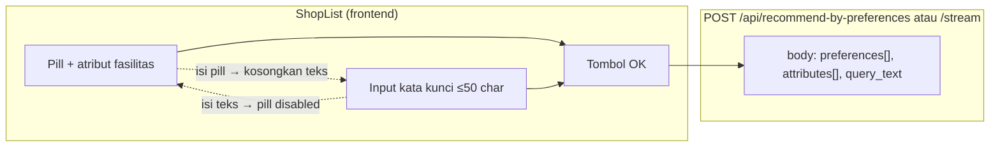
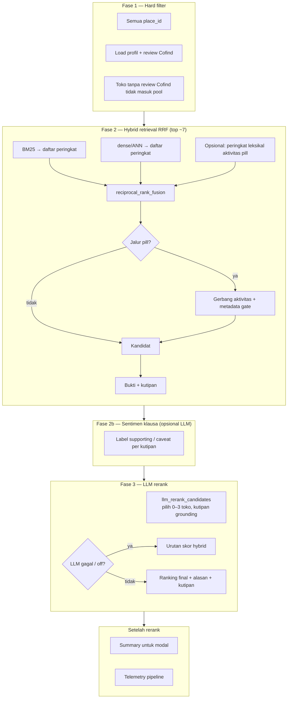
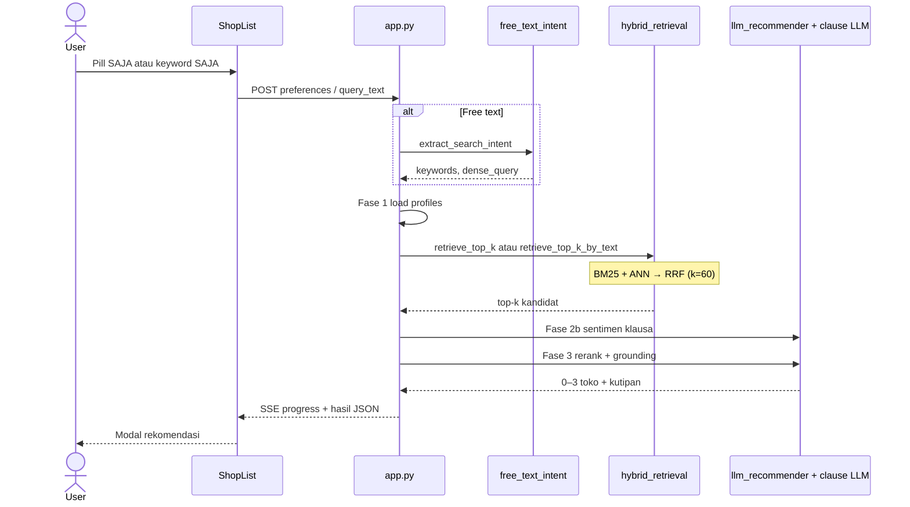

# Pipeline rekomendasi Cofind

Dokumen ini menjelaskan alur rekomendasi setelah penghapusan **preference suggestion** dan penambahan **free text** (kata kunci bebas) + **RRF** untuk retrieval.

## Ringkasan perubahan

1. **Preference suggestion dihapus** — user tidak lagi mengirim saran pill baru ke admin dari ShopList.
2. **Input: pill atau free text** — saling eksklusif di UI (`ShopList.jsx`) dan backend (`_read_recommendation_preferences`).
3. **Free text** → LLM intent → `keywords` + `dense_query` langsung ke hybrid retrieval (tanpa upgrade otomatis ke pill).
4. **Fase 2 (semua jalur):** BM25 + dense/ANN → **RRF** (`RRFscore(d)=Σ 1/(k+rank)`). Pill: + peringkat leksikal aktivitas bila perlu, gerbang aktivitas & metadata **setelah** RRF.
5. **PILL_MAPPING** untuk query pill dan metadata; free text tidak wajib map ke pill.

## Modul utama

| Lapisan | File |
|---------|------|
| UI + eksklusivitas pill ⇌ keyword | `frontend-cofind/src/pages/ShopList.jsx` |
| HTTP body (`query_text`) | `frontend-cofind/src/services/recommendationStream.js` |
| Orkestrasi pipeline | `app.py` → `_recommendation_pipeline_events`, `_read_recommendation_preferences` |
| Intent free text | `free_text_intent.py` |
| Routing query aneh (negatif / presuposis / off-domain) | `free_text_query_handling.py` |
| Hybrid retrieval + RRF | `hybrid_retrieval.py` |
| Rerank + grounding kutipan | `llm_recommender.py` |

Env terkait (lihat juga `.env.example`): `COFIND_FREE_TEXT_INTENT`, `COFIND_RRF_K`, flag hybrid/rerank/clause sentiment.

---

## 1. Dari UI ke backend



---

## 2. Cabang input (satu request = satu jalur)

```mermaid
flowchart TD
  START([Request masuk]) --> READ["_read_recommendation_preferences()"]
  READ --> V1{Ada pill?}
  V1 -->|tidak| V2{Ada query_text?}
  V2 -->|tidak| E400[400: pilih pill atau keyword]
  V1 -->|ya| V3{Juga ada query_text?}
  V3 -->|ya| E400b[400: hanya salah satu]
  V3 -->|tidak| PILL[Jalur pill: valid_pills dari body]
  V2 -->|ya| INTENT[Progress SSE: intent]

  INTENT --> LLM1["extract_search_intent → keywords + dense_query"]
  LLM1 --> FT["valid_pills = [] (hint pill hanya telemetri)"]
  PILL --> PIPE
  FT --> PIPE

  PIPE([Fase 1 → Fase 2 RRF → 2b → 3 → summary])
```



Implementasi cabang intent: `app.py` fungsi `_recommendation_pipeline_events` (sekitar baris validasi body dan blok `extract_search_intent`).

---

## 3. Fase 1 → 2 → 2b → 3



**Personalization:** sebelum Fase 3, `build_user_taste_profile` (review, favorit, vote user) masuk prompt rerank sebagai konteks selera — bukan fakta tentang kandidat.

**Feedback `not_helpful`:** tidak mengecualikan toko di Fase 1; keputusan akhir di rerank/summary.

---

## 4. Perbandingan jalur Fase 2

| | Pill | Free text (setelah intent) |
|---|------|----------------------------|
| Entry API | `retrieve_top_k` | `retrieve_top_k_by_text` |
| Query | Token + dense dari PILL_MAPPING | `keywords` + `dense_query` dari LLM |
| Inti ranking | **RRF** (BM25 + dense; + leksikal aktivitas jika pill aktivitas) | **RRF** (BM25 + dense) |
| Pasca-RRF | Gerbang aktivitas + metadata gate | — (rerank/summary menilai bukti) |
| Fase 2b & 3 | Sama | Sama |

### Free text — query_class (setelah intent LLM)

| Kelas | Contoh | Respons |
|-------|--------|---------|
| `negative_sentiment` | "coffee shop paling jelek" | Retrieval `retrieve_top_k_by_negative_sentiment` (rating/keluhan terendah); framing jujur di `message` + prompt summary/rerank |
| `false_presupposition` | "ada dinosaurus" | Abstention parsial: tidak ada match literal; retrieval pakai `alternative_keywords`; `message` menjelaskan + alternatif tematik |
| `off_domain` | teks acak | Early exit: `recommendations: []`, `message` + arahan contoh query valid |
| `standard` | "wifi kencang" | RRF biasa |

Heuristik deterministik di `merge_query_classification` melengkapi label LLM bila model off/gagal.

---

## 5. Alur end-to-end (sequence)



---

## Preview diagram

GitHub, GitLab, dan banyak editor Markdown merender blok ` ```mermaid ` otomatis. Di VS Code/Cursor, ekstensi **Markdown Preview Mermaid Support** membantu preview lokal.

## Tes terkait

- `free_text_rrf_checks.py` — RRF + intent (mock LLM)
- `tests/test_llm_recommender.py` — grounding + rerank guardrail
- `python -m unittest discover -s . -p "*_checks.py"` — suite smoke backend
