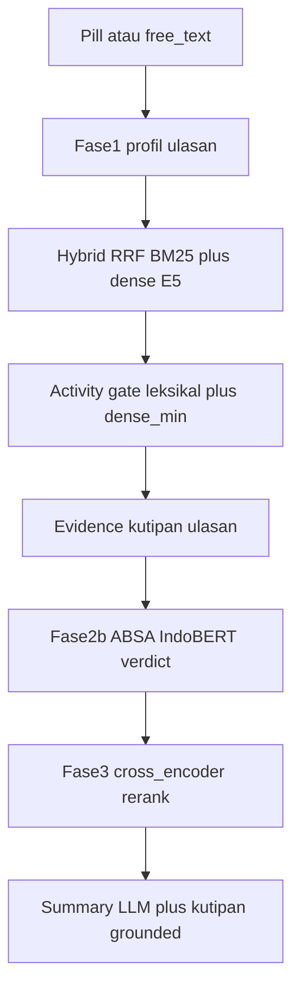
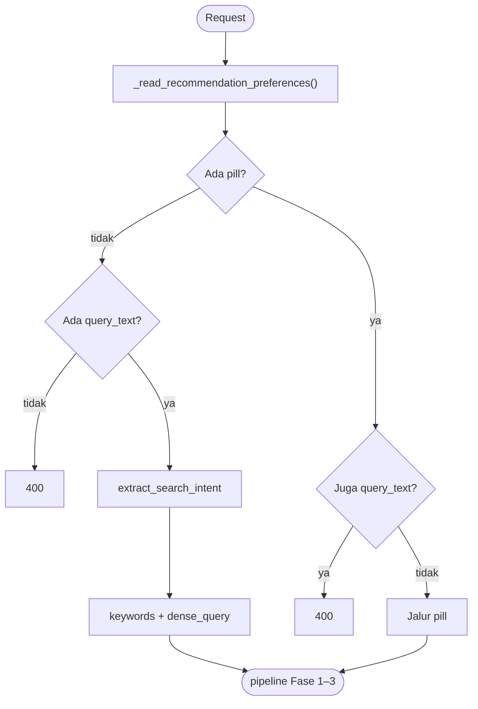

# Pipeline rekomendasi Cofind

Dokumen ini menjelaskan alur rekomendasi produksi setelah penyederhanaan untuk skripsi: **hybrid RRF → gerbang aktivitas → bukti kutipan → ABSA → cross-encoder rerank → summary LLM**. Metadata fasilitas dan LLM rerank **tidak** lagi memengaruhi ranking.

## Ringkasan arsitektur

1. **Input:** pill **atau** free text (saling eksklusif di UI dan API).
2. **Free text:** `extract_search_intent` → `keywords` + `dense_query` → hybrid retrieval.
3. **Fase 2:** BM25 + dense/ANN → **RRF**; jalur pill → **gerbang aktivitas** (leksikal + opsional cosine).
4. **Fase 2b:** **ABSA IndoBERT** (`damasukma/indobert-absa`) + triase klausa → verdict supporting/caveat per kutipan.
5. **Fase 3:** **`ce_rerank_candidates`** (Jina cross-encoder), blend dengan skor hybrid.
6. **Pasca-ranking:** summary/modal LLM (`llm_recommender.py`) dengan grounding kutipan; **bukan** rerank LLM.

Orkestrasi utama: [`recommendation/pipeline.py`](recommendation/pipeline.py) (re-export dari [`app.py`](app.py)).

## Modul utama

| Lapisan | File |
|---------|------|
| UI pill ⇌ keyword | `frontend-cofind/src/pages/ShopList.jsx` |
| HTTP + SSE | `app.py` → `_recommendation_pipeline_events` |
| Intent free text | `free_text_intent.py` |
| Query aneh / PVQR | `free_text_query_handling.py` |
| Hybrid RRF | `hybrid_retrieval.py` |
| Bukti & kutipan | `recommendation/evidence.py`, `recommendation/helpers.py` |
| ABSA Fase 2b | `llm_clause_sentiment.py`, `absa_sentiment.py`, `semantic_triage.py` |
| Rerank Fase 3 | `cross_encoder_rerank.py`, `rerank_blend.py` |
| Summary LLM | `llm_recommender.py` |

### Env aktif (subset)

| Env | Fungsi |
|-----|--------|
| `COFIND_RRF_K`, `COFIND_RRF_POOL_SIZE`, `COFIND_RETRIEVAL_TOP_K` | Retrieval |
| `COFIND_ACTIVITY_DENSE_MIN` | Telemetry / gate dense aktivitas |
| `COFIND_CROSS_ENCODER`, `COFIND_CE_RERANK*`, `COFIND_CE_RERANK_WEIGHT` | Fase 3 CE |
| `COFIND_ABSA_ENABLED`, `COFIND_TAU_LOW`, `COFIND_TAU_HIGH` | ABSA + triase |
| `COFIND_FREE_TEXT_INTENT` | Intent LLM |
| `COFIND_BM25_BACKEND`, `COFIND_EMBEDDING_MODEL` | Dense + BM25 |

Daftar lengkap: [`.env.example`](../.env.example).

---

## Diagram alur

---

## Cabang input

Free text: `MAX_FREE_TEXT_CHARS = 100` (validasi di intent/API). Kelas query (`negative_sentiment`, `false_presupposition`, `off_domain`, `standard`) di [`free_text_query_handling.py`](free_text_query_handling.py).

---

## Perbandingan jalur Fase 2

| | Pill | Free text |
|---|------|-----------|
| Entry | `retrieve_top_k` | `retrieve_top_k_by_text` |
| Query | PILL_MAPPING + dense aktivitas | keywords + dense_query (LLM) |
| Ranking | RRF + gerbang aktivitas | RRF |
| Metadata fasilitas | **Tidak** dipakai di ranking/evidence | — |

`metadata_support` / `metadata_gate` di respons API tetap kosong untuk kompatibilitas UI lama.

---

## Evaluasi (skripsi)

| Artefak | Peran |
|---------|--------|
| [`data/eval/eval_queries.json`](../data/eval/eval_queries.json) | Query eval dari calon pengguna (contoh: [`eval_queries.example.json`](../data/eval/eval_queries.example.json)) |
| [`data/eval/relevance_judgments.json`](../data/eval/relevance_judgments.json) | Label relevansi manual 0–3 |
| [`scripts/eval/relevance_metrics.py`](../scripts/eval/relevance_metrics.py) | nDCG@k, Recall@k, MRR@k |
| [`scripts/eval/threshold_tuning.py`](../scripts/eval/threshold_tuning.py) | Grid dev pada env ranking |
| [`scripts/eval/golden_retrieval_snapshot.py`](../scripts/eval/golden_retrieval_snapshot.py) | Snapshot Fase 2 tanpa CE/ABSA |

Kalibrasi parameter: [`docs/kalibrasi-parameter.md`](kalibrasi-parameter.md).

---

## Tes terkait

- `python -m pytest tests -q -p no:cacheprovider`
- `python -m unittest discover -s tests -p "*_checks.py"`
- `tests/test_llm_recommender.py` — grounding + format konteks (bukan LLM rerank)
- `tests/test_env_example_sync.py` — sinkron `.env.example` ↔ kode
- `free_text_rrf_checks.py` — RRF + intent mock
