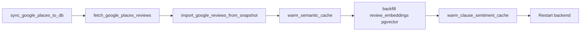

# Runbook Operasional — Data Plane Cofind

Panduan urutan manual untuk mengisi/menyegarkan korpus rekomendasi (ulasan + metadata + cache).
Bukan pengganti `.env` production; baca juga [kalibrasi-parameter.md](./kalibrasi-parameter.md).

## 0. Prasyarat

| Item | Keterangan |
|------|------------|
| Python | 3.10+ di root repo |
| Env | Salin `.env.example` → `.env`; `DATABASE_URL` / `COFIND_DB_BACKEND` |
| Google Places | Kunci API yang dipakai `fetch_google_places_reviews.py` (mis. `GOOGLE_MAPS_API_KEY`) |
| LLM (opsional) | `HF_API_TOKEN` / Gemini — untuk `warm_clause_sentiment_cache.py` |
| pgvector (opsional) | `COFIND_EMBEDDING_STORE=pgvector`, Supabase, `COFIND_PGVECTOR_DIM=384` |
| Redis (opsional) | `REDIS_URL` — cache vektor & `COFIND_EMBEDDING_ASYNC=true` + worker Celery |

Jalankan semua perintah dari **root repositori** (`cofind/`).

## 1. Diagram alur (ringkas)



Urutan disarankan: **metadata toko → snapshot ulasan → impor DB → cache/embedding → sentimen → restart**.

---

## 2. Sinkronisasi metadata tempat (Google Places → `coffee_shops`)

**Skrip:** `sync_google_places_to_db.py`

**Peran:** Impor `facilities.json` (jika ada) + sync field metadata Google ke baris `coffee_shops`.  
**Bukan** sumber utama ulasan pipeline (ulasan via impor snapshot).

```bash
# Full sync (termasuk impor JSON fasilitas jika ada)
python sync_google_places_to_db.py

# Lewati impor facilities.json
python sync_google_places_to_db.py --skip-json-import

# Uji subset
python sync_google_places_to_db.py --limit 10
```

**Keluaran:** JSON ringkasan di stdout (`shop_count`, `error_count`, …).  
**Exit code:** non-zero jika semua toko gagal.

---

## 3. Pengambilan ulasan (Places API → file snapshot)

**Skrip:** `fetch_google_places_reviews.py`

**Peran:** Panggil Google Places per baris `coffee_shops`; tulis snapshot JSON (maks ~5 ulasan/toko).

```bash
# Dry-run: daftar toko + query pencarian, tanpa API
python fetch_google_places_reviews.py --dry-run -o data/google_reviews_snapshot.json

# Produksi: fetch + simpan (default path disarankan)
python fetch_google_places_reviews.py -o data/google_reviews_snapshot.json --delay 0.35

# Satu toko
python fetch_google_places_reviews.py --place-id ChIJ... -o data/google_reviews_snapshot.json

# API New vs Legacy
python fetch_google_places_reviews.py --api new -o data/google_reviews_snapshot.json
```

**Prasyarat:** DB terisi; kunci API valid.  
**Rate limit:** atur `--delay`.

---

## 4. Impor ulasan snapshot → database

**Skrip:** `import_google_reviews_from_snapshot.py`  
**Modul:** `google_reviews_snapshot_import.py` (default `data/google_reviews_snapshot.json`)

```bash
python import_google_reviews_from_snapshot.py
python import_google_reviews_from_snapshot.py --path data/google_reviews_snapshot.json
```

**Efek:** Ulasan Google masuk korpus pipeline (`PIPELINE_REVIEW_SOURCES`); impor dapat menjadwalkan embedding (`schedule_review_embedding_after_write`) bila pgvector/async aktif.

**Verifikasi:** bandingkan jumlah review per `place_id`; UI badge Google; log Fase 1 `review_count`.

---

## 5. Pemanasan cache semantik (file/Redis)

**Skrip:** `warm_semantic_cache.py`

**Peran:** Pra-encode klausa review ke cache embedding (Fase 2 dense fallback / utilitas semantik).

```bash
python warm_semantic_cache.py --stats
python warm_semantic_cache.py
python warm_semantic_cache.py --limit 500 --batch 256
python warm_semantic_cache.py --place-id ChIJ...
```

**Prasyarat:** `sentence-transformers` terpasang; untuk encode penuh `COFIND_SEMANTIC_GATE` boleh true di `.env`.

---

## 6. Backfill embedding pgvector (`review_embeddings`)

**Konfigurasi:** `COFIND_EMBEDDING_STORE=pgvector`, `DATABASE_URL` Supabase/Postgres + ekstensi vector.

**Jalur delegasi (dari kode):**

```bash
# Windows
set COFIND_EMBEDDING_STORE=pgvector

# Linux/macOS
# export COFIND_EMBEDDING_STORE=pgvector

python warm_semantic_cache.py --pgvector
```

`warm_semantic_cache.py` memanggil `scripts/backfill_review_embeddings.py` bila ada.

> **Catatan repo:** Folder `scripts/` / file `backfill_review_embeddings.py` mungkin belum ada — jika `--pgvector` gagal, backfill lewat:
> - impor ulasan + `COFIND_EMBEDDING_ASYNC=true` + Celery worker, atau
> - upsert manual lewat `review_embedding_store.upsert_review_embedding` (operasi dev).

**Verifikasi:** `COFIND_DENSE_USE_ANN=true`, telemetry `dense.pool=ann`, `ann_reviews` > 0 pada request rekomendasi.

---

## 7. Pemanasan cache sentimen klausa (Fase 2b)

**Skrip:** `warm_clause_sentiment_cache.py`

```bash
python warm_clause_sentiment_cache.py --stats
python warm_clause_sentiment_cache.py --dry-run --limit 800
python warm_clause_sentiment_cache.py --limit 800 --max-clauses 4000
```

**Prasyarat:** `COFIND_LLM_CLAUSE_SENTIMENT=true`, LLM tersedia (kecuali `--dry-run`).  
**Biaya:** banyak panggilan LLM per label preferensi (`PILL_MAPPING`).

---

## 8. Restart backend (dan worker terkait)

### 8.1 Flask dev (lokal)

```bash
# Pastikan hanya SATU proses di port 5000 (hindari duplikat python app.py)
python app.py
```

Setelah perubahan kode Python: hentikan proses lama, lalu start ulang.

### 8.2 Produksi (contoh)

```bash
gunicorn -w 1 -b 0.0.0.0:5000 app:app
```

(Sesuaikan dengan deploy Anda.)

### 8.3 Celery (jika embedding async / summary job)

```bash
celery -A celery_app worker --loglevel=info
```

**Checklist pasca-restart**

- [ ] Health/API shops merespons
- [ ] Satu listener port 5000
- [ ] Rekomendasi pill + free text (stream) jalan
- [ ] Log Fase 2: `dense.pool`, `activity_pass_*` jika relevan

---

## 9. Urutan operasi disarankan (checklist)

| # | Langkah | Wajib? | Kapan |
|---|---------|--------|--------|
| 1 | `sync_google_places_to_db.py` | Metadata baru | Setelah tambah toko / ubah Place ID |
| 2 | `fetch_google_places_reviews.py` → snapshot | Ulasan Google | Periodik / setelah sync |
| 3 | `import_google_reviews_from_snapshot.py` | Ya, agar pipeline baca ulasan | Setelah fetch |
| 4 | `warm_semantic_cache.py` | Disarankan | Setelah banyak ulasan baru |
| 5 | Backfill pgvector | Jika ANN | Setelah (4) atau impor |
| 6 | `warm_clause_sentiment_cache.py` | Opsional | Sebelum demo; butuh LLM |
| 7 | Restart backend (+ Celery) | Ya | Setelah env/skrip data |

---

## 10. Troubleshooting singkat

| Gejala | Kemungkinan | Tindakan |
|--------|-------------|----------|
| Dense selalu max-pool | pgvector kosong / ANN off | Backfill + `COFIND_EMBEDDING_STORE=pgvector` |
| Rekomendasi tanpa ulasan Google | Belum impor | Langkah 3 |
| Dua proses port 5000 | Duplikat `app.py` | Kill PID, satu proses |
| CI lokal gagal | Env berbeda | `COFIND_SEMANTIC_GATE=false` + `unittest discover` |

---

## 11. Referensi terkait

- [arsitektur-rekomendasi.md](./arsitektur-rekomendasi.md)
- [kalibrasi-parameter.md](./kalibrasi-parameter.md)
- `.env.example` (pipeline RRF, embedding, LLM)
